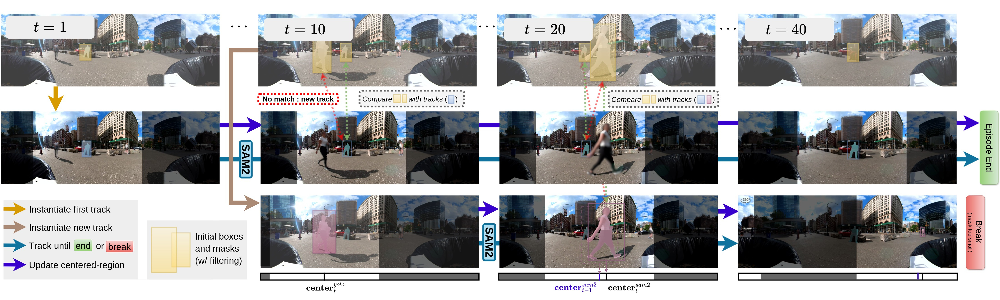

# Interact360




## Install
Requirements : CUDA equipped GPU with at least 7GB of VRAM. 3GB of disk space for checkpoints.

- Install `ffmpeg` if you dont have it already (for video extraction)
```
sudo apt-get install ffmpeg
```

- Create a conda environment and install dependencies
```
conda create --name interact360env python=3.10
conda activate interact360env
pip install -r requirements.txt
```

- Download the checkpoints (by default it will download necessary checkpoints for `SAM2.1-Tiny` and `Sapiens-03b`)
```
cd checkpoints
./download_ckpts.sh
cd ../
```

## Run

Place your video under `./demo/data` here we provide `ClubInteract-TCAn.mp4` (not a part of HUI360 or SSUP-A dataset, faces are blurred which may affect the performances)

Extract the images (this script uses ffmpeg)
```
python ./process/extract_images.py -i ./demo/data/ClubInteract-TCAn.mp4 -em time -met 60 -w 1
```

Run the detection and tracking process
```
python ./process/detect_segment_and_track.py -d ./demo/output/ClubInteract-TCAn -sm base -sibs 8

# With display (slower)
python ./process/detect_segment_and_track.py -d ./demo/output/ClubInteract-TCAn -sm base -sibs 1 --disp
```

Detect the interactions using the default mask
```
python ./process/detect_interactions.py -d ./demo/output/ClubInteract-TCAn
```

Extract keypoints with ViTPose (17 keypoints)
```
python ./process/extract_poses_vitpose.py -d ./demo/output/ClubInteract-TCAn
```

Extract keypoints with Sapiens (308 keypoints)
```
python ./process/extract_poses_sapiens.py -d ./demo/output/ClubInteract-TCAn
```

Then you can see the results in the visualizer
```
python visualize.py -d ./demo/output -rn ClubInteract-TCAn
```


## Additional informations

<details>
<summary>Download more checkpoints</summary>

Use `./download_ckpts.sh -c all` to download more sizes of checkpoint

</details>


<details>
<summary>Multiprocessing</summary>

In all scripts `-w` is used to specify the number of workers to use when things are parallelized, by default `-w` is `0` and scripts will use all cores, or half of the cores detected. In ViTPose extraction when multiple episodes are present they are parallelized depending on the available GPU VRAM.

</details>


<details>
<summary>Optimized inference</summary>

The option `-vos` enable the use optimized inference with `torch.compile` for the image encoder in SAM2-1.

The option `-b16` enable the use of `bfloat16` checkpoints for Sapiens pose extraction (only available on some GPUs, and with versions of PyTorch that are compatible with the checkpoints)

</details>


<details>
<summary>Extracting video</summary>

**Episodes duration** : use `-em` to set the episode creation method (either `single` i.e. not episode, or `time` i.e. based on a maximum duration, `detection` to create episodes only when people are in front of the camera is not implemented here), use `-met` to set the maximum episode time in seconds

**Other options** : use `-h` to check them

</details>


<details>
<summary>Detection, segmentation and tracking</summary>

The process is explained in the publication. Many options are related to the filtering, and other filtering threhsolds are set as variable at the beggining of `detect_segment_and_track.py`

- `-sibs` refers to the batch size for SAM2-Image initial segmentation (it refers to the number of persons segmented simultaneously, but anyway the full images are processed one by one)
- In the tracking phase, tracks are processed one by one, and a single image at a time 

</details>


<details>
<summary>Mask for interaction</summary>

**Fixed interaction zone** : By default we use the mask of `assets/default_mask_intersection_zone.png` update it according to your needs if you have a fixed interaction zone. 

**Moving interaction zone** : If you have a moving interaction zone (like in SSUP) you can first track the interaction zone by passing its bouding box in the first image of your sequence as `-izt xmin,ymin,xmax,ymax`, note that `xmax` can be `> width` this is the way to track an object that appears on both sides of the equirectangular image. This will create a file `interact_zone_tracking_360.json` in each episode, that will be used by default by `detect_interaction.py`.
```
python detect_segment_and_track.py -d ./demo/output/SSUP_SAMPLE_0/ -izt 2688,1042,4585,1919
```

Where `-izt 2688,1042,4585,1919` is the bounding box of the interaction zone in the first image then it will run a full pass of tracking to find the masks of the interaction zone. Then compute the convex hull of these masks. So you need a convex interaction zone, also this way of doing is not preferred because less reliable, a fix interaction zone - relatively to the camera - is better.
</details>


## Acknowledgement 
- SAM2
```
@article{ravi2024sam2,
  title={SAM 2: Segment Anything in Images and Videos},
  author={Ravi, Nikhila and Gabeur, Valentin and Hu, Yuan-Ting and Hu, Ronghang and Ryali, Chaitanya and Ma, Tengyu and Khedr, Haitham and R{\"a}dle, Roman and Rolland, Chloe and Gustafson, Laura and Mintun, Eric and Pan, Junting and Alwala, Kalyan Vasudev and Carion, Nicolas and Wu, Chao-Yuan and Girshick, Ross and Doll{\'a}r, Piotr and Feichtenhofer, Christoph},
  journal={arXiv preprint arXiv:2408.00714},
  url={https://arxiv.org/abs/2408.00714},
  year={2024}
}
```

- SAM2 Real Time : 
```
https://github.com/Gy920/segment-anything-2-real-time
```

- ViTPose
```
@inproceedings{
  xu2022vitpose,
  title={Vi{TP}ose: Simple Vision Transformer Baselines for Human Pose Estimation},
  author={Yufei Xu and Jing Zhang and Qiming Zhang and Dacheng Tao},
  booktitle={Advances in Neural Information Processing Systems},
  year={2022},
}
```

- Sapiens
```
@article{khirodkar2024sapiens,
  title={Sapiens: Foundation for Human Vision Models},
  author={Khirodkar, Rawal and Bagautdinov, Timur and Martinez, Julieta and Zhaoen, Su and James, Austin and Selednik, Peter and Anderson, Stuart and Saito, Shunsuke},
  journal={arXiv preprint arXiv:2408.12569},
  year={2024}
}
```


